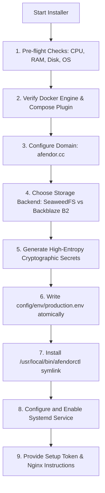

# AFENDOR CHAT — INSTALLER & CLI DESIGN SPECIFICATION

> **Utility Name:** `afendorctl` & `install.sh`  
> **Target Execution:** `curl -fsSL https://installer.afendor.cc/install.sh | bash` (future command)  
> **Architecture Decision:** Native Modular Shell Architecture over Go binary  

---

## 1. Architectural Decision: Rexctl vs. Afendorctl

Fluxer's upstream installer (`rexctl`) is a 20,000+ line Go application with complex charmbracelet terminal UI, systemd boot unit generation, and an automated binary self-update system tied to GitHub releases of `fluxerapp/fluxer`.

### The Decision: Dedicated Native CLI (`afendorctl`)
For a private personal installation on Ubuntu VPS, maintaining `afendor_rexctl` as a compiled Go binary introduces severe liabilities:
1. **No Public Binary Mirror:** Fluxer `rexctl` downloads pre-compiled binaries from public GitHub Releases. Because Afendor Chat is private and not published to public repositories, the self-update and binary distribution mechanisms fail.
2. **Build Dependencies:** Compiling Go on the VPS requires toolchains that violate the requirement to minimize host-level software.
3. **Auditability & Stability:** A native POSIX/Bash installer (`install.sh`) and command utility (`afendorctl`) directly orchestrates Docker Compose, requires zero compilation, works on any standard Ubuntu release, and can be read and audited in seconds.

At the same time, the source tree for `afendor_rexctl` is preserved and maintained in the repository for developer use or future compilation if desired.

---

## 2. Installer Workflow (`install.sh`)

When executed on the VPS, `install.sh` conducts the following sequence:



### Pre-flight Validation
- **CPU:** Asserts >= 2 vCPUs.
- **RAM:** Asserts >= 4000 MB available.
- **Disk:** Asserts >= 15 GB available on the target mount.
- **Docker:** Detects `docker` and `docker compose`. Offers automated installation via `get.docker.com` if absent.
- **Port Conflicts:** Ensures port `8080` (edge) and `7880` (livekit) are free from host conflicts.

---

## 3. Cryptographic Secret Generation

The installer generates cryptographically secure secrets via OpenSSL (`openssl rand -hex` and `openssl rand -base64`):

```bash
AFENDOR_POSTGRES_PASSWORD=$(openssl rand -hex 18)
AFENDOR_SEARCH_API_KEY=$(openssl rand -hex 24)
AFENDOR_LIVEKIT_API_SECRET=$(openssl rand -hex 24)
AFENDOR_SUDO_MODE_SECRET=$(openssl rand -hex 32)
AFENDOR_CONNECTION_INITIATION_SECRET=$(openssl rand -hex 32)
AFENDOR_PROFILE_PSEUDONYM_SECRET=$(openssl rand -hex 32)
AFENDOR_MEDIA_PROXY_SECRET_KEY=$(openssl rand -hex 32)
AFENDOR_ADMIN_SECRET_KEY_BASE=$(openssl rand -hex 32)
AFENDOR_ADMIN_OAUTH_CLIENT_SECRET=$(openssl rand -hex 32)
AFENDOR_SETUP_TOKEN=$(openssl rand -hex 24)
AFENDOR_MEDIA_PROXY_UPLOAD_RELAY_SECRET_BASE64=$(openssl rand -base64 32)
AFENDOR_MEDIA_PROXY_ATTACHMENT_URL_SECRETS_BASE64=$(openssl rand -base64 32)
```

The resulting `config/env/production.env` file is set to permissions `chmod 600` so only `root` can inspect it.

---

## 4. Systemd Boot Unit Integration

The installer creates `/etc/systemd/system/afendor.service`:

```ini
[Unit]
Description=Afendor Chat Service Stack
After=docker.service network-online.target
Requires=docker.service

[Service]
Type=oneshot
RemainAfterExit=yes
WorkingDirectory=/opt/afendor
ExecStart=/usr/local/bin/afendorctl start
ExecStop=/usr/local/bin/afendorctl stop

[Install]
WantedBy=multi-user.target
```

This guarantees that whenever the GCP VPS reboots, Docker Compose starts the entire Afendor Chat stack automatically without manual intervention.

