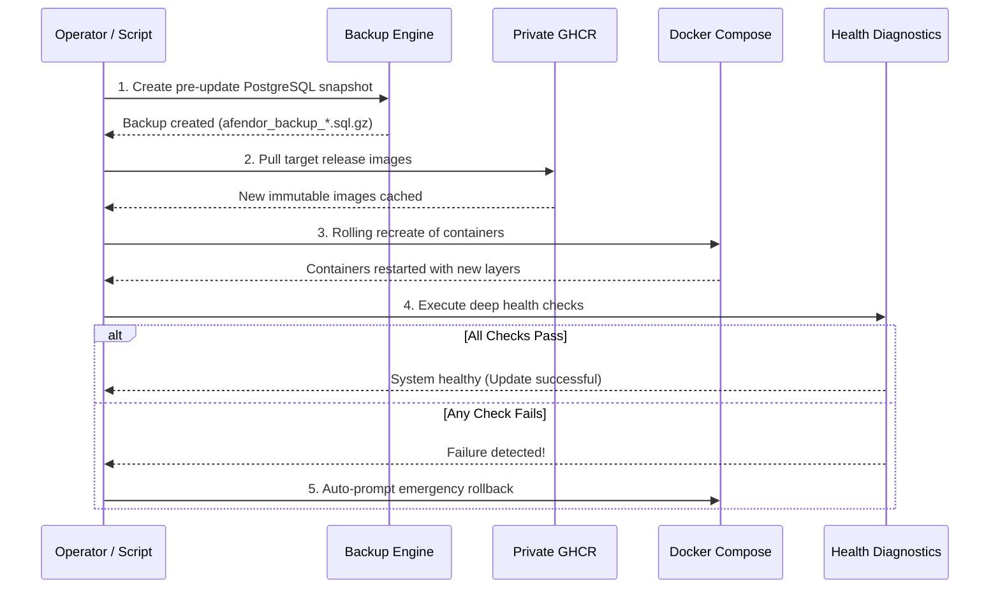

# AFENDOR CHAT — SAFE UPDATE & ROLLBACK PROCEDURES

> **Standard Rule:** Updates must NEVER drop persistent volumes, run blind `prune -a` commands, or proceed without a database snapshot.  
> **Tooling:** Automated via `afendorctl update` and `afendorctl rollback`  

---

## 1. Safe Update Architecture

The update procedure executes a deterministic 5-step sequence:



---

## 2. Executing an Update

### Automated Method:
```bash
sudo afendorctl update
```

### Manual Step-by-Step Method:
```bash
cd /opt/afendor

# Step 1: Backup database
sudo bash deploy/scripts/backup.sh

# Step 2: Pull updated images
sudo docker compose -f deploy/compose/docker-compose.yml pull

# Step 3: Rolling restart
sudo docker compose -f deploy/compose/docker-compose.yml up -d --remove-orphans

# Step 4: Verify health
sudo bash deploy/scripts/healthcheck.sh
```

---

## 3. Emergency Rollback Procedure

If an update introduces a regression or unhealthy containers:

### Automated Rollback:
```bash
sudo afendorctl rollback
```

### Manual Rollback Steps:
1. Stop the application services:
   ```bash
   sudo docker compose -f deploy/compose/docker-compose.yml stop api worker
   ```
2. Locate the pre-update database backup in `/opt/afendor/backups/`:
   ```bash
   ls -lt /opt/afendor/backups/afendor_backup_*.sql.gz | head -n 1
   ```
3. Restore the database:
   ```bash
   sudo bash deploy/scripts/restore.sh /opt/afendor/backups/<backup_filename>.sql.gz
   ```
4. Re-pin the previous image tag in `config/env/production.env` (e.g. `AFENDOR_VERSION=v1.0.0`).
5. Restart the stack:
   ```bash
   sudo afendorctl start
   ```
6. Run health diagnostics:
   ```bash
   sudo afendorctl health
   ```

